# Calculator API

A secure, fast calculator web service built with FastAPI and Pydantic, with a responsive frontend and full Docker support. All calculations are performed server-side using safe expression parsing — no `eval()` or `exec()`.

---

## Project Overview

This project is a calculator web service that accepts math expressions via a REST API and returns results. It supports basic arithmetic (addition, subtraction, multiplication, division), exponentiation, and multi-term expressions. It tracks calculation history in memory, provides a health-check endpoint, and serves a responsive HTML frontend at the root URL.

The frontend sends all calculations to the backend via `fetch()` — no math is performed in the browser.

### Key Features
- **REST API** — dedicated endpoints for each operation plus a general expression parser
- **Safe expression parsing** — uses Python's `ast` module with strict validation (no `eval()`/`exec()`)
- **Calculation history** — stores the last 20 results in memory with auto-cleanup
- **Full test coverage** — 54 tests covering all endpoints, edge cases, and error conditions
- **Docker-ready** — production image under 127MB
- **Responsive frontend** — mobile-friendly calculator UI served from the same container

---

## Project Initialization and Folder Structure

After executing euron init, the Euron Coding Agent initialized the project memory and created the required configuration and instruction files in the main project folder, named Euron Coding Agent.

For the initial vague prompt experiment, Euron Code created main.py and requirements.txt directly in the main folder. These files were kept in their original location to preserve the initial implementation for comparison.

Later, while executing the specific prompts based on the approved master specification, the agent created a separate folder named calculator-project inside the main folder. The complete end-to-end calculator application, including the FastAPI backend, Docker implementation, frontend, tests, and documentation, was developed inside this folder.

This folder organization allows us to maintain the initial vague-prompt output separately and compare it with the more structured implementation generated using specific prompts.

---

## Technologies

| Component | Technology | Version |
|-----------|------------|---------|
| Language | Python | 3.11 |
| Framework | FastAPI | >= 0.100.0 |
| Server | Uvicorn | >= 0.23.0 |
| Validation | Pydantic | >= 2.0 |
| Testing | pytest + httpx | >= 7.0 / >= 0.24.0 |
| Container | Docker (python:3.11-alpine) | — |
| Frontend | HTML | — |

---

## API Endpoints

| Method | Endpoint | Description |
|--------|----------|-------------|
| GET | `/health` | Health check — returns `{"status": "healthy"}` |
| GET | `/` | Serve the frontend calculator UI |
| POST | `/add` | Add two numbers: `{"a": 1, "b": 2}` → `{"result": 3}` |
| POST | `/subtract` | Subtract b from a: `{"a": 5, "b": 3}` → `{"result": 2}` |
| POST | `/multiply` | Multiply two numbers: `{"a": 4, "b": 5}` → `{"result": 20}` |
| POST | `/divide` | Divide a by b: `{"a": 10, "b": 2}` → `{"result": 5}` |
| POST | `/power` | Raise a to the power of b: `{"a": 2, "b": 8}` → `{"result": 256}` |
| POST | `/calculate` | Evaluate an expression: `{"expression": "2 + 3 * 4"}` → `{"result": 14}` |
| GET | `/history` | Get calculation history (last 20 entries) |
| GET | `/docs` | Auto-generated Swagger UI (FastAPI) |
| GET | `/redoc` | Alternative ReDoc documentation |

---

## Installation

### Prerequisites
- Python 3.11 or later
- Docker (for containerized deployment)

### Install Dependencies

```bash
pip install -r requirements.txt
```

`requirements.txt` contains:
- `fastapi>=0.100.0`
- `uvicorn>=0.23.0`
- `pytest>=7.0.0`
- `httpx>=0.24.0`

*(Pydantic is pulled in automatically by FastAPI)*

---

## Local Execution

### Start the Server

```bash
cd calculator-project
uvicorn app.main:app --reload
```

The server starts on **http://localhost:8000** by default.

- **Frontend:** http://localhost:8000/
- **Swagger UI:** http://localhost:8000/docs
- **Health check:** http://localhost:8000/health

### Run API Tests

```bash
cd calculator-project
python -m pytest tests/test_main.py -v
```

Expected output: **54 passed**

---

## Swagger Documentation

FastAPI auto-generates interactive API documentation:

- **Swagger UI:** http://localhost:8000/docs
- **ReDoc:** http://localhost:8000/redoc

Both are available automatically when the server is running. No manual setup required.

---

## Testing Instructions

### Run All Tests

```bash
cd calculator-project
python -m pytest tests/test_main.py -v
```

### Test Coverage

| Test Class | Tests | What It Covers |
|------------|-------|----------------|
| TestHealth | 1 | Health check endpoint |
| TestAdd | 5 | Addition with various values |
| TestSubtract | 5 | Subtraction with various values |
| TestMultiply | 5 | Multiplication with various values |
| TestDivide | 6 | Division including divide-by-zero error |
| TestPower | 4 | Exponentiation with various values |
| TestCalculate | 19 | Expression parsing: basic math, parentheses, edge cases, invalid input |
| TestHistory | 10 | History storage, retrieval, max limit (20), auto-cleanup |

**Total: 54 tests**

### Run a Single Test Class

```bash
python -m pytest tests/test_main.py::TestCalculate -v
```

---

## Docker Build and Run

### Build the Image

```bash
docker build -t calculator-api .
```

### Run the Container

```bash
docker run -d --name calculator -p 8000:8000 calculator-api
```

- The container runs uvicorn in production mode
- Access the app at **http://localhost:8000**
- Health check: **http://localhost:8000/health**

### Docker Image Size

**127MB** (verified — based on python:3.11-alpine with only FastAPI, Uvicorn, and Pydantic)

### Clean Up

```bash
docker rm -f calculator
docker rmi calculator-api
```

---

## Frontend Usage

The frontend is a responsive HTML calculator served at **GET /**. It:

- Communicates with the backend via `fetch()`
- Sends expressions to `POST /calculate` — **all math is done by the backend**
- Displays calculation history from `GET /history`
- Does **not** perform any local calculations
- Supports keyboard input for numbers and operators
- Works on mobile and desktop with a responsive grid layout
- Uses safe DOM manipulation (`textContent` instead of `innerHTML`) to prevent XSS

### Frontend Buttons
- `0`–`9`: Digits
- `+`, `-`, `×`, `÷`, `^`: Operators
- `(`, `)`: Parentheses
- `C`: Clear
- `⌫`: Backspace
- `=`: Calculate (sends to backend)
- `History`: Toggle history panel

Note : Always remember, never commit sensitive credentials; store keys and passwords in `.env`, provide a `.env.example` template, and add `.env` to `.gitignore`.

---

## Vague Versus Precise Prompt Comparison

| Comparison Area | Vague Prompt | Precise Prompt |
|---|---|---|
| Prompt instructions | Asked for a simple, runnable calculator using Python and FastAPI. | Provided a detailed specification for Part 1 of the approved project plan. |
| Project scope | Left the implementation details open to the agent. | Clearly limited the work to the FastAPI backend; Docker and frontend were postponed. |
| Files and structure | Created `main.py` and `requirements.txt`. | Followed the approved project structure and updated `prompts.md`. |
| API endpoints | Basic calculator functionality was implemented, but the exact endpoint requirements were not specified. | Explicitly required all eight API endpoints. |
| Operation documentation | Swagger did not clearly specify the supported mathematical operations; the operation field accepted a generic string. | The detailed requirements gave the agent clearer implementation expectations. |
| Input validation | Validation requirements were not specified in detail. | Explicitly required Pydantic validation. |
| Expression evaluation | The evaluation approach was left to the agent. | Explicitly required a safe AST-based expression parser. |
| Calculation history | Not requested in the initial prompt. | Required in-memory calculation history. |
| Automated testing | A complete test suite was not requested. | Required a complete pytest test suite and execution using `pytest -v`. |
| Error handling and fixes | The initial result was checked manually; an improvement was identified during code review. | Test errors occurred initially, and the agent made the required changes to fix them. |
| Test outcome | The API ran successfully. | All 53 tests passed after the fixes. |
| Implementation decisions | The agent made assumptions because the instructions were broad. | Requirements and implementation scope were clearly defined by the prompt. |

### Key Observations

**Vague prompt:** Euron Code created a basic working FastAPI calculator, but some implementation details were left to its own assumptions. During review, I noticed that the Swagger documentation did not clearly define the supported mathematical operations.

**Precise prompt:** Euron Code implemented the specified backend features, created automated tests, fixed the errors encountered during testing, and updated the project documentation. All 53 tests passed. Calculation history stores only successfully completed operations; invalid inputs and failed calculations are not saved.

### Learning

A vague prompt gives the AI coding agent more freedom to make assumptions, while a precise prompt communicates clear requirements, scope, and expected outcomes. Reviewing the generated code and running tests are still important, even when the prompt is detailed.

---

## Code Review and Correction Details

### Issue 1: XSS Vulnerability — **Fixed**

**Location:** `static/index.html`, history rendering function

**Problem:** The history entries were rendered using `innerHTML` with user-controlled data from the backend:
```javascript
div.innerHTML = '<div class="expr">' + h.expression + '</div><div class="res">= ' + h.result + '</div>';
```
If `expression` or `result` contained HTML/JavaScript (e.g., `<script>alert('XSS')</script>`), it would execute in the browser.

**Fix:** Replaced `innerHTML` with safe DOM API calls using `textContent`:
```javascript
const exprDiv = document.createElement('div');
exprDiv.className = 'expr';
exprDiv.textContent = h.expression;
```
`textContent` treats all content as plain text — no HTML is ever parsed or executed.

**Why this matters:** Even though the backend controls the data, defense-in-depth means every layer should sanitize input. This follows the principle of never trusting data sources, even internal ones.

---

## Euron Code Usage Tracking

### Today's Usage

- Tokens Used: 5,341,417
- Requests: 325
- Sessions: 2
- Tasks: 24

---

## Screenshots

### Allowance Usage at Start
Shows the Euron Code agent's allowance usage before starting the project.

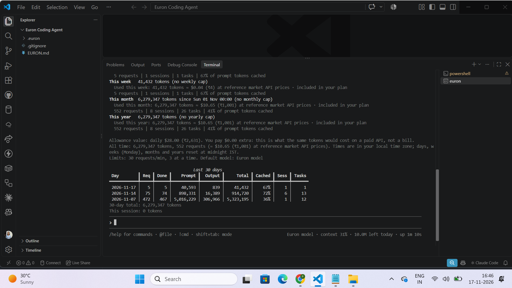

### Agent Implementation Plan
Shows the implementation plan generated by the Euron Coding Agent before development.

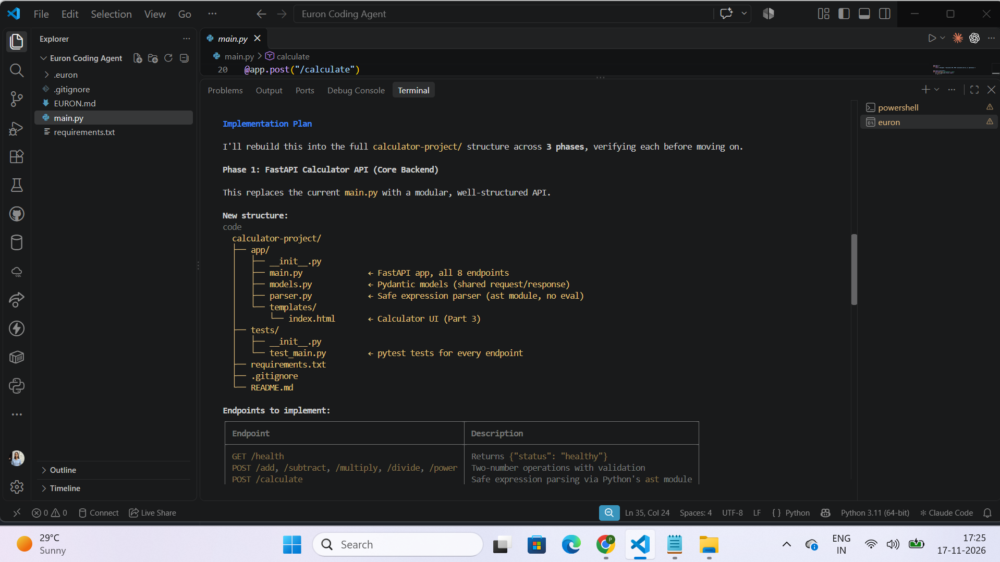

### Agent Fixing Errors
Shows the Euron Coding Agent identifying and fixing an issue during development.

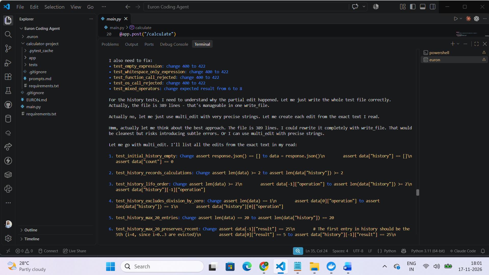

### Swagger UI
Shows the interactive Swagger documentation available through FastAPI.

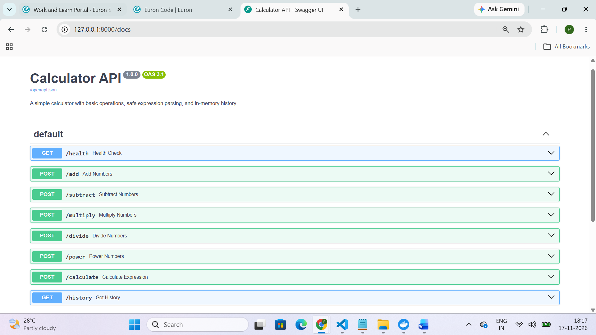

### Swagger Endpoint Test Results
Shows the API endpoint execution and response results through Swagger UI.

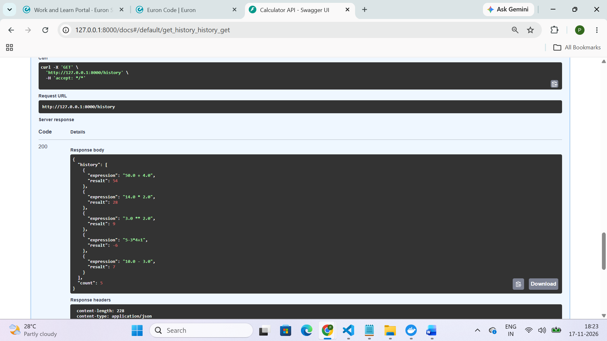


### Docker Image Creation
Shows the Docker image build process for the Calculator API.

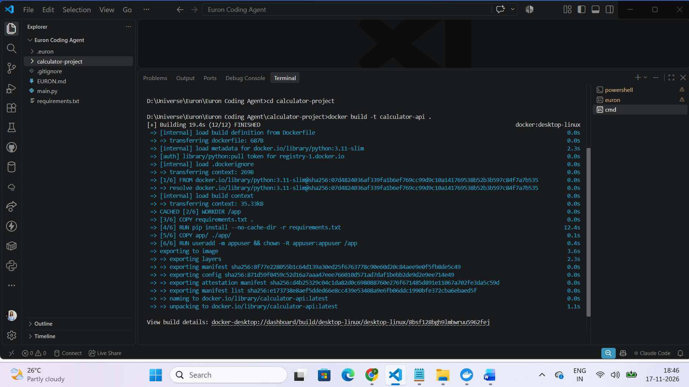

### Running Docker Container
Shows the Calculator API running inside a Docker container.

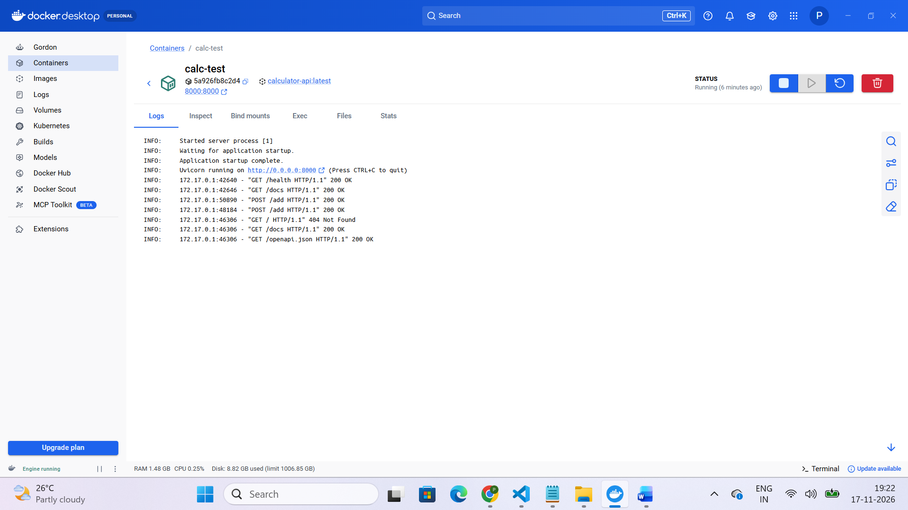

### Docker Image Optimization Prompt
Shows the prompt provided to Euron Code to optimize the Docker image size.

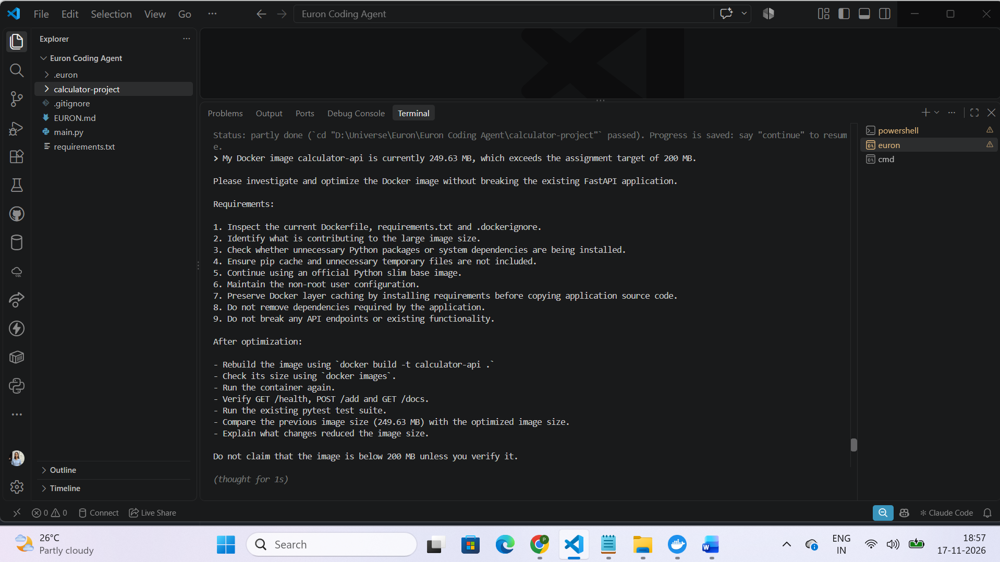

### Docker Image Size Comparison
Shows the Docker image size details before and after optimization.

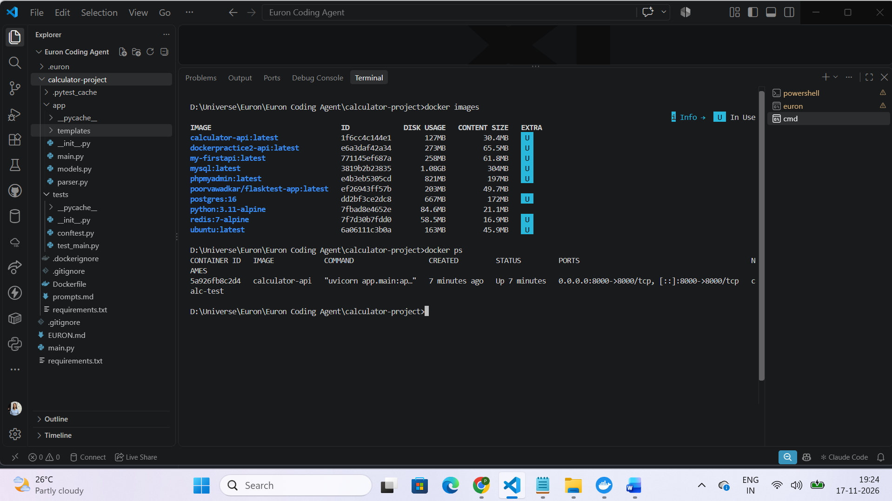

### Calculator Application with Results
Shows the interactive calculator frontend executing calculations through the FastAPI backend.

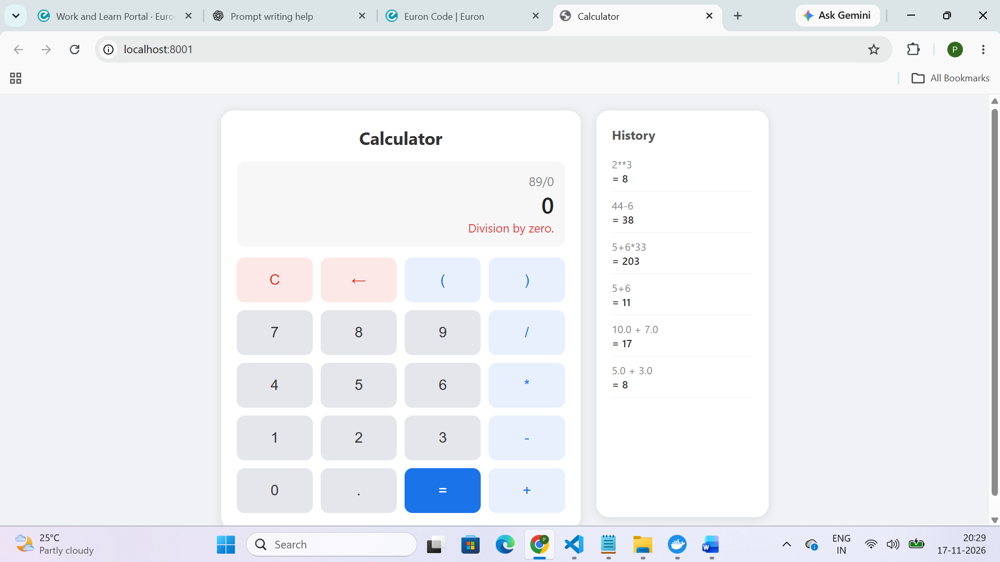

### All Tasks Completed
Shows the final project completion summary generated during the development process.

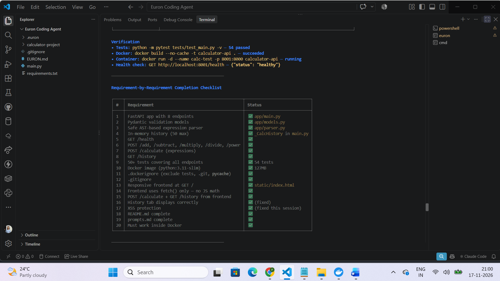

### Allowance Usage at End
Shows the Euron Code agent's allowance usage after completing the project.

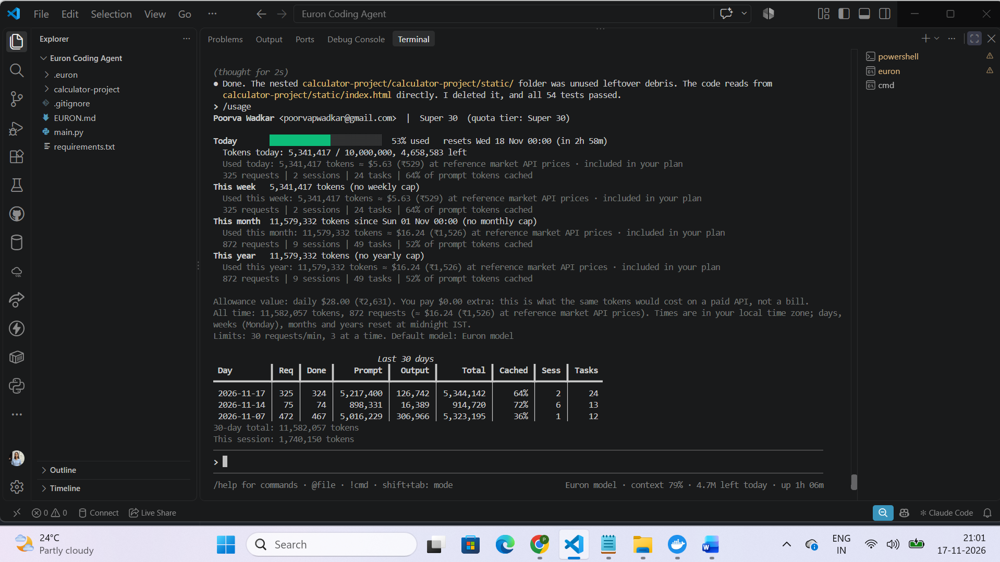
